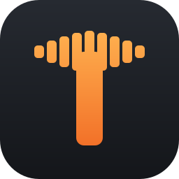

# TStudio



Eigene DAW in Rust (egui + cpal), FL-Workflow: Channel Rack → Patterns → Playlist → Mixer.

## Starten

```bash
cargo run -p tstudio --release
```

Die fertige Exe liegt danach unter `target/release/tstudio.exe`.

## Externe Tools (für Download & MP3)

```bash
winget install yt-dlp.yt-dlp
```

```bash
winget install Gyan.FFmpeg
```

Danach im „Sample-Cutter“ (F10, unten „Sample-Download“) auf „Tools neu suchen“ klicken (oder App neu starten). Alternativ den Pfad zur Exe in den Einstellungen setzen.
Entpackte Release-Zips werden auch direkt auf den Laufwerken gefunden (z.B. `E:\ffmpeg\…\bin\ffmpeg.exe`, `D:\Tools\yt-dlp`).

## Instrumente & Sound

- **TSynth** – 2 Oszillatoren, Filter, Hüllkurven, LFOs, Pitch-Hüllkurve und Drive; Presets u.a. „Hard Kick“, „Acid“, „Hard Stab“.
- **Sampler** – Samples, Tempo-Anpassung (Stretch/Resample), Chop.
- **SoundFont (.sf2)** – Channel Rack „+ SoundFont…“, Doppelklick auf eine .sf2 in der Library oder Datei ins Fenster ziehen;
  Preset-Auswahl (mit Suche, Bank 128 = Drum-Kits) im Instrument-Fenster.
- **Mixer** – 13 Effekte inkl. **Sidechain**, **Autotune**, **Clipper** (4× Oversampling), **Multiband**-Sättigung und
  **OTT** (Multiband-Kompression aufwärts/abwärts), **Sends** und **Bus-Ausgang** pro Spur
  (z.B. Kick → Rumble-Bus mit Hall + Distortion + Filter + Sidechain). **Visueller EQ**: Kurve mit drei ziehbaren Punkten
  (Low/Mid/High; Mausrad auf Mid = Breite, Doppelklick = 0 dB).
- **Vocals aufnehmen** – 🎤 in der Transportleiste (Strg+Shift+R): spielt den Song ab dem Playhead und nimmt das Mikrofon auf;
  Stop oder 🎤 beendet den Take. Er landet als WAV in `<Sample-Ordner>/Recordings/` und als Clip auf einer freien „Vocals“-Spur,
  geroutet auf den Mixer-Insert „Vocals“ (wird mit Autotune angelegt). Die Latenz der Soundkarte wird automatisch ausgeglichen
  (Feinkorrektur: „Versatz“). Rechtsklick auf 🎤: Mikrofon wählen, Pegel, **Mithören** über den Vocals-Insert (live mit Autotune,
  nur mit Kopfhörern). Mikrofon-Zugriff muss in Windows (Datenschutz → Mikrofon → Desktop-Apps) erlaubt sein.
- **Autotune** (Mixer-Effekt) – zieht Gesang auf Tonart + Skala (Dur, Moll, Harm. Moll, Phrygisch, Pentatonik, Chromatisch).
  Retune 0 ms = harter Roboter-/T-Pain-Effekt, 50–150 ms = natürlich; Stärke, Transpose (±12 HT), Mix. Formanten bleiben
  erhalten (PSOLA), Konsonanten/Atmer laufen unverändert durch. ~26 ms Verzögerung, wird bei Audio-Clips automatisch ausgeglichen.
- **Pitch & Formant** – Audio-Clips und Sampler lassen sich in jedem Tempo-Modus pitchen, ohne dass sich die Länge ändert;
  „Formant halten“ verhindert den Micky-Maus-Effekt bei Stimmen.
- **Song-Marker** – Intro/Break/Drop als gelbe Fähnchen im Playlist-Lineal (per CLI `marker add`, Abschnitte mit `section copy/insert/delete`).
- **Analyse & Mix-Check (CLI)** – Beat-Grid mit Downbeat, Akkord-Zeitleiste, Tonart, Kick-Grundton (`tune`), Schnitt im Beat-Raster,
  Mix-Report mit LUFS/True Peak/Bändern/Maskierung pro Spur, Vergleich mit Referenz-Track, Stems pro Mixer-Spur.
- **Automation-Clips** – Playlist „+ Automation“: jede Lautstärke/Pan, jeder Effekt- und TSynth-Parameter; Kurve unten im
  Clip-Editor zeichnen (Rampe, Dreieck, Sägezahn je Beat). Wirkt im Song-Modus.
- **Sample-Cutter** (F10) – MP3/WAV öffnen oder aus der Library ziehen, Hits werden erkannt: ←/→ springt Hit für Hit (spielt sofort),
  Taste 1–9 speichert die Auswahl direkt als Kick/Snare/Clap/Hat/Perc/Bass/Vocal/Loop/FX in `<Sample-Ordner>/_TStudio/Cuts/<Kategorie>`
  (normalisiert, Fades, Stille weg, Nulldurchgang) – sofort in der Library. H = alle Hits der Auswahl einzeln, „⇥ Beats“ für Loops.
  **Isolieren**: Zero-Phase-EQ mit ziehbaren HP/LP/Band-Griffen über dem Spektrum, Mitte/Seiten (Vocals raus/rein), Presets
  (Kick/Sub, Bass, Snare/Clap, Hi-Hats, Vocals …), I = A/B. Wirkt auf Vorhören, Wellenform und Speichern.
  **🎚 Stems trennen** (KI, Demucs): zerlegt den Song in Drums/Bass/Vocals/Rest unter `<Sample-Ordner>/Stems/<Song>/`.
  Läuft nur auf der CPU (niedrige Priorität, Kernzahl in den Einstellungen; Standard = halbe Kerne), nie auf der Grafikkarte.
  Einmalig installieren: `winget install Python.Python.3.12`, dann
  `python -m pip install torch==2.5.1 torchaudio==2.5.1 --index-url https://download.pytorch.org/whl/cpu` und
  `python -m pip install demucs soundfile`. Einstellungen → „Installation prüfen“.
- **Patterns in der Playlist** – Rechtsklick auf eine freie Stelle → „Neues Pattern mit …“ (vorhandener Kanal oder neues Instrument)
  öffnet direkt die Piano Roll. Pattern-Clip am rechten Rand (Griff) länger ziehen = Pattern wiederholt sich (↻-Markierungen).
  Linksklick auf freie Stelle malt das aktuelle Pattern, Rechtsklick auf einen Clip löscht ihn, Doppelklick öffnet ihn.
- **Samples im Mixer** – jedes Sample, das aus der Library/dem Ordner in die Playlist kommt, bekommt automatisch einen eigenen
  Mixer-Insert (benannt nach der Datei; weitere Clips derselben Datei teilen ihn). „🎚 Effekte im Mixer“ im Clip-Panel öffnet ihn.
- **Sample-Clips wiederholen & automatisieren** – Audio-Clip länger ziehen (oder „↻ ×2/×4/×8“ im Clip-Panel) = das Sample läuft
  in Schleife. „〰 Automation: Lautstärke / Filter-Sweep / Pan“ gibt dem Sample einen eigenen Mixer-Insert und legt darunter
  einen gleich langen Automation-Clip an (Filter: Tiefpass 300 Hz → 20 kHz).
- **Mute & Solo** – Channel Rack: pro Kanal **M** (stumm) und **S** (Solo; Klick = nur dieser Kanal, Strg+Klick = weitere dazu),
  die LED zeigt, ob der Kanal gerade zu hören ist. Mixer: **M**/**S** oben in jedem Strip.
- **Spuren** – Playlist-Spuren mit M/S-Knöpfen (Strg+Klick auf S = mehrere Solos), Rechtsklick auf den Spurkopf:
  umbenennen, einfügen, duplizieren, verschieben, löschen; Mixer-Strips per Rechtsklick genauso (Routing wandert mit).
- **Spur-Lautstärke** – Balken unten im Playlist-Spurkopf ziehen (Doppelklick = 100 %, bis 125 %); wirkt auf Samples und
  Pattern-Noten der Spur.
- **Kopieren & Einfügen** – Playlist: Strg+C/X/V (fügt an der Maus bzw. am Playhead ein), Strg+D duplizieren, Alt+Ziehen kopiert,
  Strg+A alles. Piano Roll: Strg+C/X/V für Noten. Channel Rack: Strg+C/V kopiert die Steps des gewählten Kanals auf einen anderen.
  Pattern-Clip anklicken → „⧉ Eigene Kopie“ macht daraus ein eigenständiges Pattern.
- **Loop-Bereich** – im Playlist-Lineal ziehen (Ränder verschiebbar, Rechtsklick = aus), „⟲ Loop“ bzw. Strg+L = um die
  markierten Clips oder 4 Takte ab Playhead.
- **Transport** – Master-Lautstärke und Swing direkt neben BPM. Leertaste spielt im Channel Rack / in der Piano Roll das
  Pattern, in der Playlist den Song; „▶ Pattern“ im Channel Rack.
- Beim ersten Start werden vorhandene Sample-Ordner automatisch in die Library übernommen
  (Documents/lmms/samples, FL Studio Mobile Factory Data, Music/Samples …).

`Tracks/Schranz Demo` zeigt alles zusammen (155 BPM: Hard Kick, Rumble-Bus, Acid mit Filter-Automation, SoundFont-Strings im Break).

## Wichtigste Tastenkürzel

| Taste | Aktion |
|---|---|
| Leertaste | Play/Stop (Rack/Piano Roll: Pattern, Playlist: Song) |
| Strg+C / X / V / D | Kopieren / Ausschneiden / Einfügen / Duplizieren (Playlist, Piano Roll, Rack) |
| Strg+L | Loop-Bereich an/aus (Playlist) |
| L | Pattern-/Song-Modus |
| F5 / F6 / F7 / F8 / F9 / F10 | Playlist / Channel Rack / Piano Roll / Instrument / Mixer / Sample-Cutter |
| Strg+Z / Strg+Y | Rückgängig / Wiederholen |
| Strg+S / Strg+O / Strg+N | Speichern / Öffnen / Neu |
| Strg+R | Exportieren |
| Piano Roll: Strg+A/C/V/D, Entf, Pfeiltasten, Q | Auswahl, Kopieren, Einfügen, Duplizieren, Löschen, Verschieben, Quantisieren |

## Aufbau

| Crate | Inhalt |
|---|---|
| `crates/dsp` | Synth, Sampler, 9 Effekte (inkl. Sidechain), WSOLA-Time-Stretch, BPM-/Key-/Transienten-Erkennung |
| `crates/engine` | Echtzeit-Audio-Thread (lock-frei), Mixer-Routing, Automation, SoundFont-Wiedergabe (rustysynth), Offline-Render |
| `vendor/rustysynth` | rustysynth 1.3.8 (MIT) mit Fix: SoundFonts mit leeren Instrumenten werden geladen statt abgelehnt |
| `crates/project` | Datenmodell, `.tsp`-Dateien (RON), Undo/Redo |
| `crates/library` | Ordner-Scan, Dekodierung (wav/mp3/flac/ogg/m4a), Analyse-Cache |
| `crates/fetch` | yt-dlp / ffmpeg |
| `crates/app` | Oberfläche |
| `crates/cli` | `tstudio-cli` – Bedienung per Kommandozeile (JSON-Ausgabe) |

Tests: `cargo test --workspace`

Logo: `assets/logo.svg` / `assets/logo.ico` (Geometrie in `crates/app/src/logo.rs`, daraus auch Fenster- und Exe-Icon;
neu erzeugen mit `cargo test -p tstudio write_logo_assets -- --ignored`).

## CLI & Claude-Plugin

`target/release/tstudio-cli.exe` bedient Projekte ohne GUI: Kanäle, Noten, Playlist, Mixer-FX, beliebige Parameter
(`get`/`set` über JSON-Pfade), Rendern + Audio-Analyse, Stretch/Trim/Chop, Library-Scan, Download. Übersicht: `tstudio-cli --help`.

```bash
tstudio-cli status
tstudio-cli notes steps live -p 0 -c 0 "x...x...x...x..."
tstudio-cli clip add live --pattern 0 --track 1 --bar 1 --repeat 4
tstudio-cli render live song.wav
tstudio-cli render live song.mp4 --artist "DJ-Name" --accent cyan --size vertical   # Video mit Visualizer
```

**Video-Export:** Exportieren → Format „MP4-Video (Visualizer)“ (oder `render … out.mp4`) baut automatisch ein Video:
Spektrum-Ring, der zur Kick pulsiert, Oszilloskop, Partikel, DJ-Name mit Glow, Tracktitel und Fortschrittsbalken.
Gerendert wird nur auf der CPU, ffmpeg kodiert H.264 + AAC 320k. Größen: 1080p, 720p, Hochkant (Reels/TikTok), Quadrat.
Der DJ-Name wird in den Einstellungen gespeichert; `--still 42 out.png` zeigt ein Standbild als Vorschau.

Statt eines Dateipfads nimmt jeder Befehl auch `live`: das Projekt, das gerade in TStudio offen ist (inkl. ungespeicherter
Änderungen). Die Änderung erscheint sofort im Fenster und ist dort mit Strg+Z rückgängig zu machen; gespeichert wird erst mit
Strg+S bzw. `tstudio-cli save`. `tstudio-cli status` zeigt, ob und was offen ist; `tstudio-cli open datei.tsp` lädt ins laufende
Fenster. Technisch: TStudio lauscht auf 127.0.0.1 (zufälliger Port + Token in `%APPDATA%/TStudio/TStudio/config/live.json`).

Das Claude-Plugin (`claude-plugin/`, Skill `tstudio`) bringt Claude bei, die CLI zu benutzen. In diesem Ordner ist es über
`.claude/settings.json` bereits eingetragen; global installieren: `/plugin marketplace add E:\TStudio`, dann `/plugin install tstudio@tstudio`.
